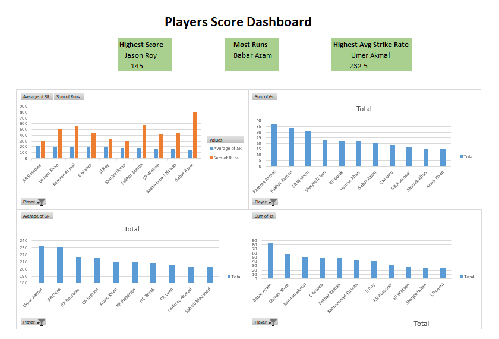

# PSL Batting Dashboard (Excel)

An Excel dashboard analyzing the 100 highest individual innings in Pakistan Super League history (2016-2024): who scored the most, who scored the fastest and who hit the most boundaries.

## Dashboard Preview

## Business Questions
- Which batters appear most often among the highest PSL innings, and who scored the most runs across them?
- Who scores fastest (strike rate), and is that driven by one big innings or consistent hitting?
- Who hits the most sixes and fours?

## Dataset
- Source: [Kaggle - Pakistan Super League Datasets](https://www.kaggle.com/datasets/muhammadkhalid/pakistan-super-league-datasets) (file: Highest individual score)
- Size: 100 innings by 45 players, from February 2016 to March 2024
- Columns: Player, Runs, Mins, Balls, 4s, 6s, SR (strike rate), Team, Opposition, Ground, Match Date, plus a calculated Runs Per Ball column
- **Scope note:** the data is the list of the 100 highest individual scores, not every PSL innings. All totals and averages below are across these 100 innings only, not career statistics.

## Workbook Structure
| Sheet | Contents |
|---|---|
| Highest individual score | The cleaned data (100 rows) |
| Pivot Tables | Four pivot tables and their charts |
| Dashboard | KPI cards and four charts, with gridlines hidden |

## What I Did
1. **Cleaned the data:** removed the asterisk (not-out marker) from the Runs column so it is numeric, replaced a "-" in the 6s column with 0, and left 54 blank "Mins" values empty because the source did not record them.
2. **Added a calculated column:** Runs Per Ball (Runs / Balls).
3. **Built four pivot tables:** total runs with average strike rate, total sixes, total fours, and average strike rate by player, each filtered to the top 10.
4. **Designed the dashboard:** KPI cards for highest score, most runs and highest average strike rate, with a Top 10 chart for each measure.

## Key Findings
- **Highest score:** Jason Roy made 145 off 63 balls (strike rate 230.15) for Gladiators against Zalmi at Rawalpindi on 8 March 2023.
- **Most runs across these innings:** Babar Azam, with 804 runs in 9 innings, the most appearances in the list. His average strike rate of 151.6 is the lowest among the top five run scorers, which makes him the accumulator of the group.
- **Most sixes:** Kamran Akmal hit 37 in 6 innings, ahead of Fakhar Zaman (34) and Shane Watson (31). Babar Azam leads in fours with 85.
- **Fastest scoring:** Umar Akmal has the highest average strike rate (232.5), but from a single innings. Among players with two or more innings, BR Dunk leads (231.9), followed by RR Rossouw (216.7).
- **Volume and speed together:** Usman Khan scored 503 runs in 5 innings at an average strike rate of 199.1. Kamran Akmal's 77 off 27 balls is the fastest single innings in the list (strike rate 285.18).
- **Where and when:** Karachi hosted the most of these innings (29 of 100), followed by Lahore (19). The average strike rate across all 100 innings is 178.8.

## Limitations and Next Steps
- Players with a single innings (such as Umar Akmal's strike rate) are not directly comparable to players with several, so averages should be read with the innings count in mind.
- Because only the top 100 innings are included, the dashboard describes exceptional performances, not typical batting performance.
- Next: use the full ball-by-ball PSL data to get career statistics, and repeat the analysis in SQL or Python.

## How to Open
Download `PSL_Batting_Dashboard.xlsx` and open it in Microsoft Excel. The pivot tables are on the Pivot Tables sheet and the finished dashboard is on the Dashboard sheet.

## Tools Used
Microsoft Excel (Pivot Tables, charts, calculated columns, KPI cards)

## Author
Shaheer Samad Waien | [LinkedIn](https://linkedin.com/in/shaheer-waien) | shaheerwaien@hotmail.com
